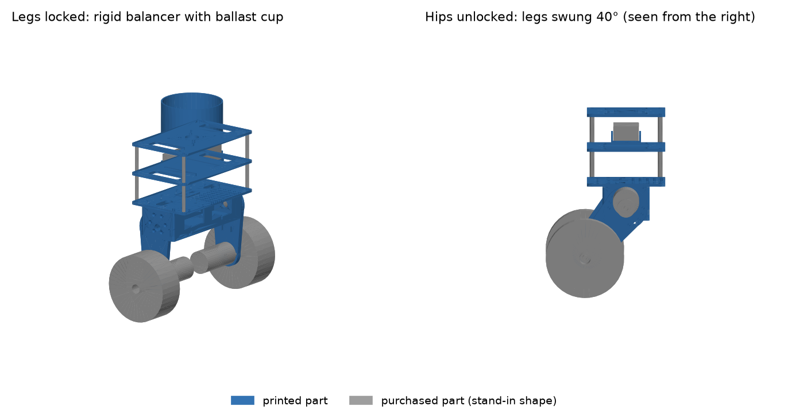

# BRI v0 printed chassis



Parametric CadQuery model. Edit the numbers in `Params` at the top of `bri_chassis.py`, then run it to regenerate everything in `export/`.

```
python bri_chassis.py        # needs cadquery (the session used cadquery 2.8.0 from PyPI)
```

Outputs in `export/`: one STEP and one STL per printed part (already in print orientation), `bri_v0_assembly.step` (printed parts plus grey stand-in shapes for purchased parts), and `chassis_report.json` (sizes, interference check, mass estimate).

## Printed parts

| Part | Qty | Size (mm) | Solid volume (cm3) | Estimated mass (g) | Print notes |
|---|---|---|---|---|---|
| `hip_block` | 1 | 66 x 180 x 48 | 120 | 84 | base down, no supports; 4 walls, 30 % infill |
| `leg` | 2 | 60 x 135 x 8 | 47 | 33 | outer face down (as exported), no supports; 5 walls, 40 % infill; left and right are the same part |
| `deck_electronics` | 1 | 110 x 180 x 6 | 75 | 52 | flat, IMU pad up |
| `deck_battery` | 1 | 110 x 180 x 4 | 67 | 47 | flat |
| `battery_tray` | 1 | 42 x 116 x 18 | 24 | 16 | floor down |
| `deck_top` | 1 | 110 x 180 x 4 | 67 | 47 | flat |
| `ballast_cup` | 1 | 100 x 100 x 60 | 72 | 51 | floor down; 3 walls is enough |

Mass assumes PETG at 55% effective fill. Weigh one printed part and correct `MASS_NOTES` in the script.
The largest footprint is 180 x 110 mm; check it fits the printer bed. Material: PETG or similar; PLA will creep at the motor mounts.

## Key dimensions (from `chassis_report.json`)

| | |
|---|---|
| Wheel track (centre to centre) | 249 mm |
| Outside width over the wheels | 294 mm |
| Hip axis above ground, legs straight | 145 mm |
| Top deck above ground | 277 mm |
| Estimated total mass, no ballast / with 1.5 kg | 1.84 / 3.39 kg |
| Interference between parts at hip angles 0, 30, 60, 90 degrees | none found |
| Free hip swing | +/-120 degrees (contact at 125) |

## Measure these before printing (assumed in the model)

1. **Hub bolt circle.** `hub_bolt_circle = 19.05` mm for the Pololu 1999 hub is assumed. Check the Pololu drawing or measure the hub.
2. **Battery size.** `batt_l, batt_w, batt_h = 108, 36, 26` mm is a typical 3S 2200 mAh pack, not the real one.
3. **Wheel hub.** The wheels are drawn as plain cylinders. The hub that joins the 6 mm D-shaft to the wheel sets `wheel_gap`.
4. **IMU board.** The pad has two slots for screws 10 to 30 mm apart.

## Hardware

| Use | Fastener |
|---|---|
| Hip motors to hip block (6 holes each) | M3 x 8 flat head. 5 mm wall + 3 mm into the gearbox, which is the maximum allowed engagement |
| Wheel motors to legs (6 holes each) | M3 x 10 socket or button head, in the 1 mm counterbores |
| Legs to hip hubs (6 each) | M3 x 10 socket head from the inner face, heads sunk in the counterbores |
| Leg lock bolts (2 per leg) | M3 x 16 with a 1 mm washer in the gap, into M3 heat-set inserts in the hip block |
| Electronics deck to hip block (4) | M3 x 10 into M3 heat-set inserts |
| Deck spacing | 8 x M3 hex standoff, 45 mm, male-female, plus 4 screws and 4 nuts |
| Battery tray (2) | M3 x 12 flat head with wing nuts under the deck; two hook-and-loop straps |
| Driver and regulator boards | M2 x 6 with nuts |
| Ballast cup or jump motor (4) | M4 x 12 with nuts |

## Assembly order

1. Press the eight heat-set inserts into the hip block (four on top, two in each side wall).
2. Slide the first hip motor in and push its shaft out through the wall. The second motor needs the first one already seated to have room. Fit the flat-head screws and tie each motor to its saddle.
3. Bolt a hub to each leg from the inner face, then bolt a wheel motor to each leg.
4. Slide each leg and hub onto its hip shaft, set the 1 mm gap with the washers, fit both lock bolts, then tighten the hub set screws on the shaft flat.
5. Fit the electronics deck (IMU pad up), then the standoffs, battery deck, tray, standoffs and top deck.
6. For the mass test, bolt the ballast cup to the top deck and fill it to the target mass on a scale.

## What was checked, and what was not

- Checked in CAD: every part is a single valid solid; screw positions were tested with pins placed through the motor, hub and lock patterns; no part overlaps another at the hip angles listed above.
- Not checked: nothing has been printed or assembled. Strength, stiffness and fit are unverified. The top mass sits on two levels of M3 standoffs and may sway; brace or shorten them if it does.
