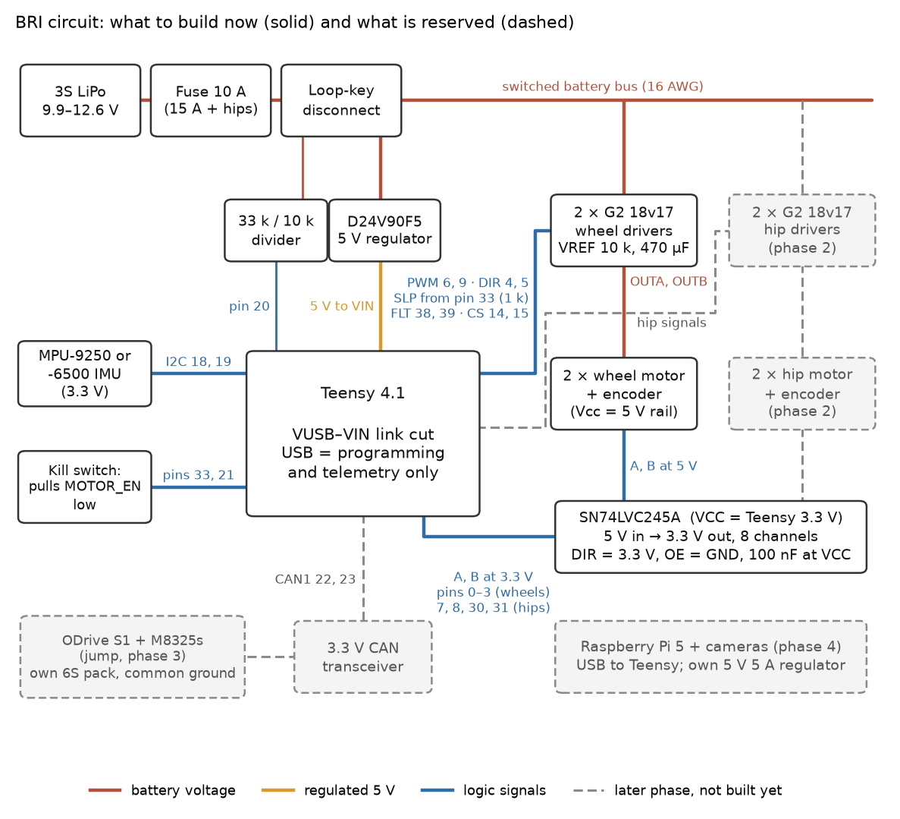

# BRI circuit build (phase 1: simple balancer)

Solid blocks are built now. Dashed blocks are reserved for later phases (`JOINT_DESIGN.md`, `FUTURE_JUMP_AND_COMPUTE.md`).
Nothing in this document has been built or measured yet. Every value marked *proposed* needs the check listed beside it.
The same tables are in the workbook sheets **Pin Map** and **Wiring**.

## 1. Power tree

| Stage | Part | Value | Why |
|---|---|---|---|
| Source | 3S LiPo | 9.9 to 12.6 V | Pack model still TBD in the workbook |
| Protection | Inline blade fuse, close to battery + | 10 A now, 15 A with hips (*proposed*) | Two stalled motors draw 11 A; the drivers are limited to about 5 A each. Re-size from measured current (ELEC-005) |
| Disconnect | XT60 loop key (*proposed*) | rated above 30 A | A pull-out plug is a visible, reachable way to remove all motor power (SYS-006) |
| Motor bus | 16 AWG to a distribution point, 20 AWG to each driver | battery voltage | Short, twisted pairs |
| Bulk capacitor | 470 uF, 25 V, low ESR, one per driver, in the driver's + and - holes | | Pololu asks for a few hundred uF close to the driver |
| Logic supply | D24V90F5 | 5 V | Feeds Teensy VIN and encoder Vcc |
| 3.3 V | Teensy 3.3 V pin | under 250 mA | Feeds the IMU and the SN74LVC245A only |

All grounds meet at the distribution point: battery, both drivers (power GND and logic GND), regulator, Teensy.

## 2. Teensy power

1. Run CV-001 from USB first.
2. Then cut the VUSB to VIN link on the underside of the Teensy 4.1 and feed VIN from the 5 V rail. After the cut, USB carries data only and the regulator can never feed the computer (ELEC-006).

## 3. Motor driver wiring (one G2 18v17 per motor)

| G2 pin | Connects to | Note |
|---|---|---|
| VIN, GND (large holes) | motor bus, ground | 470 uF across + and - |
| OUTA, OUTB | motor red, motor black | fix direction in the firmware config, not by swapping wires |
| PWM | Teensy 6 (left), 9 (right) | low = brake, so nothing moves at boot |
| DIR | Teensy 4 (left), 5 (right) | |
| SLP | MOTOR_EN net | the board pulls SLP high, so the net needs its own pull-down |
| FLT | Teensy 38 (left), 39 (right), INPUT_PULLUP | open drain, low = fault |
| CS | Teensy A0 (left), A1 (right) | 50 mV + 20 mV/A; wire it directly, no capacitor |
| VREF to GND | 10 k resistor (*proposed*) | lowers the 40 A default limit to about 5 A on the datasheet curve; that part of the curve is inaccurate, so measure it in CV-007 |
| GND (logic side) | Teensy GND | |

**MOTOR_EN net:** Teensy pin 33 -> 1 k -> net -> both wheel SLP pins. 10 k from the net to GND. Kill switch (pole 1) from the net to GND. Teensy pin 21 reads the net.
Check before the first motor test: with the Teensy unpowered and the drivers powered, the net must read below 0.4 V. If it does not, the driver's pull-up is stronger than assumed; lower the pull-down to 2.2 k.
Fit a two-pole switch now so pole 2 is ready for HIP_EN (pin 32) in phase 2.

## 4. Encoders and the SN74LVC245A

Pololu 4756 cable: red = motor +, black = motor -, green = encoder GND, blue = encoder Vcc, yellow = A, white = B (as recalled from the Pololu product page; confirm on the motor label).
Encoder Vcc is the 5 V rail because the encoder needs at least 3.5 V. Its outputs therefore swing to 5 V and must pass through the level shifter.

SN74LVC245A in DIP-20, powered from 3.3 V. Its inputs accept 5 V when it runs from 3.3 V (TI datasheet as recalled; confirm).

| Chip pin | Name | Connects to |
|---|---|---|
| 1 | DIR | 3.3 V (direction A to B) |
| 2 | A1 | left wheel encoder A (yellow) |
| 3 | A2 | left wheel encoder B (white) |
| 4 | A3 | right wheel encoder A |
| 5 | A4 | right wheel encoder B |
| 6 to 9 | A5 to A8 | GND for now; hip encoders in phase 2 (left A, left B, right A, right B) |
| 10 | GND | ground |
| 18 | B1 | Teensy pin 0 |
| 17 | B2 | Teensy pin 1 |
| 16 | B3 | Teensy pin 2 |
| 15 | B4 | Teensy pin 3 |
| 14, 13, 12, 11 | B5 to B8 | Teensy pins 7, 8, 30, 31 in phase 2 |
| 19 | OE (active low) | GND (always enabled) |
| 20 | VCC | Teensy 3.3 V, with 100 nF to GND at the pin |

The chip is one-directional and push-pull. Do not put it on the I2C lines.

## 5. IMU and battery sense

- IMU: 3.3 V, GND, SDA to pin 18, SCL to pin 19. Pull-ups go to 3.3 V only. Add 4.7 k pull-ups only if the breakout has none.
- Battery sense: 33 k from the switched bus to pin 20, 10 k from pin 20 to GND, 100 nF across the 10 k. 12.6 V reads 2.93 V at the pin.
- Low-voltage thresholds (*proposed*, pending the pack datasheet): warn at 10.5 V, stop at 9.9 V.

## 6. Build order and the test that closes each step

| Step | Build | Run (in `firmware/tests/`) |
|---|---|---|
| 1 | Teensy on USB only | `cv001_power_usb` |
| 2 | Battery lead, fuse, loop key, regulator | `cv002_5v_regulator` |
| 3 | Cut VUSB to VIN, power Teensy from 5 V | `cv001_power_usb` again (no backfeed) |
| 4 | IMU on 3.3 V | `cv003_i2c_scan`, `cv004_imu_raw`, `cv005_imu_pitch` |
| 5 | One driver, VREF resistor, capacitor, MOTOR_EN net; motor unplugged | `cv006_driver_logic` |
| 6 | Plug in the motor, wheel off | `cv007_motor_noload` |
| 7 | Level shifter and that motor's encoder | `cv008_encoder_waveform` (scope both sides of the chip), `cv009_encoder_cal` |
| 8 | Repeat 5 to 7 for the second wheel | same tests on channel 1 |
