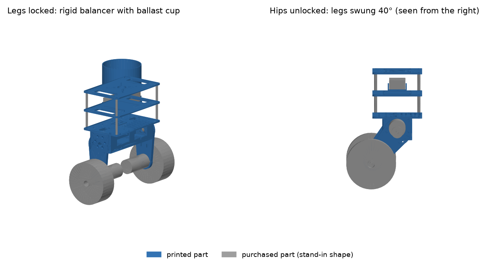

# Hip joint design: would an actuated joint help with stairs and uneven terrain?

**Short answer.** A joint driven by the two spare Pololu 4756 gearmotors is workable and is built into the v0 chassis as a lockable hip.
It helps with stance trim, side-to-side levelling, slopes and getting back up after a fall. It does not make household stairs reachable.
All numbers below are static estimates from `analysis/joint_feasibility.py` using the CAD mass model; none is measured.

*Left: legs locked (phase 1). Right: legs swung 40 degrees. The picture keeps the body upright; a balancing robot would lean the body back so its mass stays over the axle.*

## What the numbers say

| Quantity | Bare robot | With 1.5 kg on the top deck | Limit |
|---|---|---|---|
| Body mass above the hips | 1.08 kg | 2.63 kg | |
| Body centre of mass above the hip axis | 41 mm | 109 mm | |
| Hip holding torque at 20 / 45 degrees | 0.16 / 0.34 N*m | 0.4 / 0.82 N*m | 0.98 continuous, 2.45 instantaneous |
| Usable leg swing while balancing | 27.0 deg | 57.8 deg | |
| Height and levelling range | 9.8 mm | 42.0 mm | |
| Cross-slope that can be levelled | 2.2 deg | 9.6 deg | |
| Torque to stand the body up from lying flat | 0.22 N*m per hip | 1.4 N*m per hip | 0.98 continuous, 2.45 instantaneous |
| Hip speed (no load) / resolution | 456 deg/s, 0.043 deg per count | same | |

Step height by rolling alone is limited by tyre grip, not torque: 8 mm at friction 0.6, 12 mm at 0.8, 16 mm at 1.0 for a 110 mm wheel.

## Why the range is small on the bare robot

To balance, the body's centre of mass must sit over the wheel axle. When the leg swings by an angle, the axle moves away from the hip by
(leg length x sin(angle)), and the body has to lean to follow it. The body can only shift its mass as far as its centre of mass is above the hip.
The two hip motors are the heaviest items in the body and they sit on the hip axis, so the bare body's centre of mass is only 41 mm up.
Mass added higher (battery deck raised, Pi 5, jump module) widens the range, until the gearbox continuous torque becomes the limit.

## What the hip is good for, and what it is not

| Task | Verdict | Reason |
|---|---|---|
| Household stairs (risers near 180 mm) | Not feasible | Rolling climbs 8 to 16 mm; the hip changes stance, not step height |
| Thresholds, cable covers, rough floor | Helped a little | Levelling and stance trim; wheel size still sets the limit |
| Cross-slopes | Helped | Levels 2.2 to 9.6 degrees depending on top mass |
| Getting up after a fall | Feasible | 0.22 N*m per hip bare; a short high-torque move with top mass |
| Resting without balancing | Feasible | Lower the body onto the ground with the hips |
| Climbing onto a kerb by resting the body on it and swinging the legs up | Untested idea | Geometry reaches roughly a leg length; needs simulation or a careful bench test before any claim |

## How it is built

- `CAD/bri_chassis.py`: the hip block holds the two hip motors end to end. Each leg bolts to a Pololu 1999 hub on a hip shaft and carries one wheel motor.
- **Phase 1:** two M3 lock bolts per leg pin the leg to the body. The chassis behaves as a rigid balancer. Hip drivers need not be wired.
- **Phase 2:** remove the lock bolts, wire the hip drivers and encoders (pins in `PIN_MAP.md`), and limit hip angle in firmware to +/-110 degrees. The CAD sweep shows the wheel motor meeting a deck standoff at 125 degrees.
- Extra lock holes at 20 and 40 degrees let the leg be pinned at a swing angle to test a crouched stance before the hips are powered.

## Risks to manage

1. **Backlash.** An unlocked hip puts a second gearbox between the IMU and the wheels. Tune balance with the legs locked. In phase 2 keep the legs swung by 15 degrees or more so gravity keeps the gears loaded on one side.
2. **Zero angle.** The encoders are incremental. Choose a homing method (lock-bolt position, or a hard stop found by current) before enabling the hips.
3. **Cables.** The wheel-motor cable must run up the leg with a slack loop at the hip. The leg has tie slots for this.
4. **Shock loads.** The gearbox instantaneous rating is 2.45 N*m. Do not drop the robot onto unlocked hips.

## If more range is needed later

- Raise the battery deck or carry the Pi 5 and jump module high on the body.
- Replace the single link with a two-link leg whose lower link is geared 2:1 to the body, so the wheel stays under the hip while the leg folds. This is a concept only; it is not designed or checked.
- Use both spare motors on one swing arm (a tail) instead of two hips: double the torque and nothing in the balance path, but no levelling.
